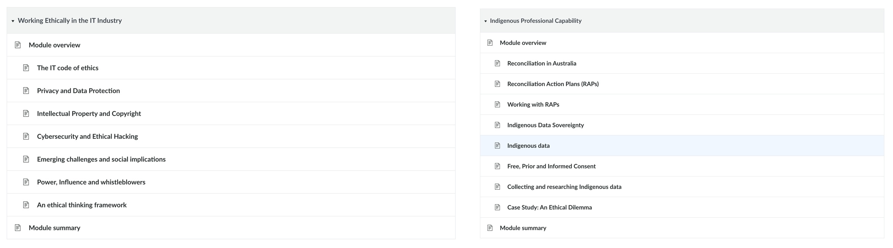
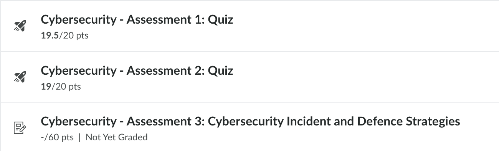
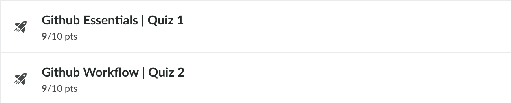
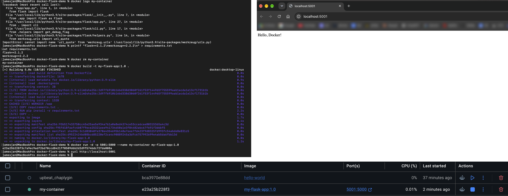
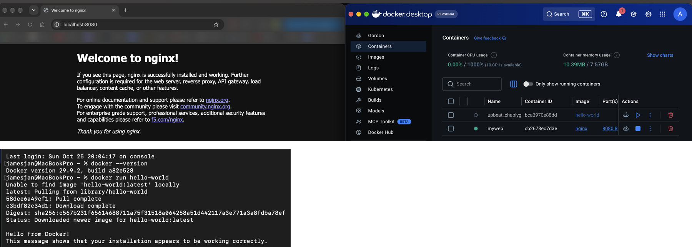
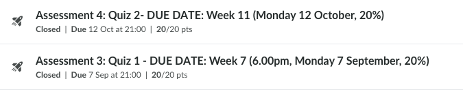
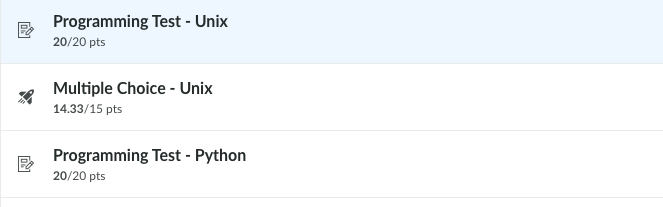

# Professional Portfolio – James An

**Cloud infrastructure and DevSecOps · UTS Master of IT**

After ten years as a videographer, director, producer and editor, I'm moving into
cloud infrastructure and DevSecOps. This portfolio records my learning and the
evidence behind it.

**Target roles:** Junior Cyber Security Engineer (BizCover) → Cloud Engineer – AWS,
Kubernetes & Terraform (HCLTech)

---

## Professional Learning Plan – UTS 43030 Professional Practice in Computing (2026)

This section holds the evidence for my Professional Learning Plan (Assessment Task 1).
It follows the same four goals as my Professional Learning Report (Assessment Task 3).

| Goal | Learning | Result |
|---|---|---|
| 1. Ethics & Indigenous capability | Working Ethically + Indigenous Professional Capability | Both modules completed; Assessment 2 submitted |
| 2. Cybersecurity foundations | Introduction to Cybersecurity | Quiz 1: 19.5/20 · Quiz 2: 19/20 · Assessment 3 submitted |
| 3. Software development tools | Software Development: GitHub Essentials & Workflow | Quiz 1: 9/10 · Quiz 2: 9/10 · Workflow activities completed |
| 4. Cloud & containers | Software Development: Docker Essentials, supported by 42891 | Python app containerised and debugged · 42891 Quiz 1: 20/20 · Quiz 2: 20/20 |

### Goal 1 – Ethics and Indigenous Professional Capability
I completed both ethics modules, covering the ACS Code of Ethics, privacy, intellectual
property, Indigenous Data Sovereignty and Free, Prior and Informed Consent. In
Assessment 2, I applied the AIATSIS and ACS codes to a company plan to sell
AI-generated "Indigenous Australian Imagery", and recommended commissioning
Indigenous artists instead.

### Goal 2 – Cybersecurity Foundations
I completed the cybersecurity module: security goals and risk assessment; cyber threat
intelligence and secure coding; and an incident analysis. For Assessment 3, I analysed
the 2022 Medibank data-extortion attack. I traced how a stolen contractor password and
a VPN without multi-factor authentication exposed 9.7 million customers, and proposed
a layered defence based on the Essential Eight and Zero Trust.

### Goal 3 – Software Development Tools
I completed GitHub Essentials and GitHub Workflow. In a team repository, I built a
GitHub Actions workflow in YAML that updates a web page for each team member, logs
each commit to the README, and commits back to `main` using `GITHUB_TOKEN`.

### Goal 4 – Cloud Infrastructure and Containers

**Docker Essentials (43030 Software Development module).** I installed Docker Desktop
and containerised a Python Flask web app: I wrote the `Dockerfile`, built the image
with `docker build`, and ran it with `docker run`, mapping a host port to the container.

The container built successfully but crashed on start. Using `docker logs`, I found an
`ImportError` caused by a version clash: the course pins Flask 2.1.2, but pip installed
the latest Werkzeug, which removed a function old Flask depends on. I fixed it by
pinning a compatible version (`werkzeug==2.2.2`) in `requirements.txt`, rebuilt the
image, and the app served "Hello, Docker!" from the container.

> **Lesson:** pin *every* dependency, not just the main one, or a container that
> builds today can break tomorrow.

I also ran an nginx web server in a container on my Mac:

**Supporting learning: 42891 Infrastructure for Cloud Computing.** My plan listed this
subject as a resource for this goal (details below).

Outside my subjects, I have also completed most of an AWS Cloud Practitioner course,
which I plan to finish and sit the exam for in the summer break.

---

## Related UTS Subjects

### 32547 UNIX Systems Programming (Spring 2026)
Practical systems programming in the UNIX environment: command line, bash shell
scripting, Python scripting, regular expressions in shell and Python, and sockets
and inter-process communication.

| Assessment | Result |
|---|---|
| Programming Test – Unix shell | 20/20 |
| Multiple Choice – Unix | 14.33/15 |
| Programming Test – Python | 20/20 |

### 42891 Infrastructure for Cloud Computing (Spring 2026)
Hands-on labs in cloud virtualisation and data-centre infrastructure: building VMs on
VMware ESXi, iSCSI and NFS storage, vCenter Server and VM migration, virtual switches
and resource management, plus cloud security and public vs private cloud. Group
project: a cloud infrastructure design and prototype for SmartV (I wrote the business
requirements).

| Assessment | Result |
|---|---|
| Quiz 1 | 20/20 |
| Quiz 2 | 20/20 |

---

## Next steps
1. AWS Certified Cloud Practitioner – Dec 2026 to Feb 2027
2. Docker in GitHub Actions, then Terraform – 2027
3. Security scanning in the CI/CD pipeline – 2027
4. AWS Solutions Architect – Associate and Kubernetes (EKS) – late 2027 to 2028
